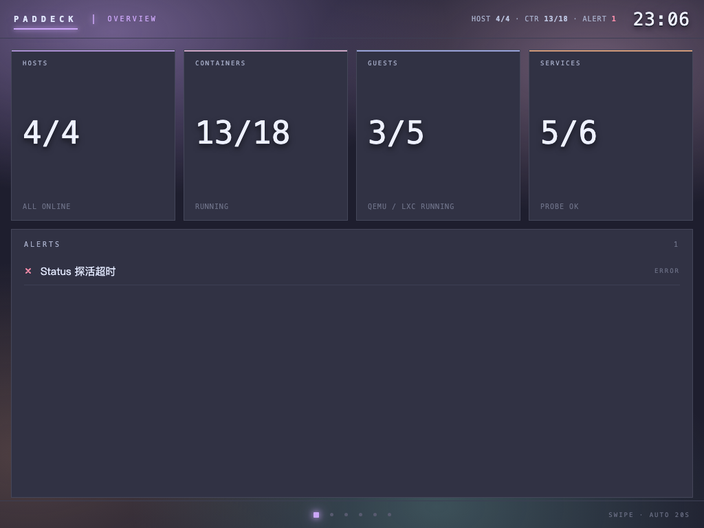
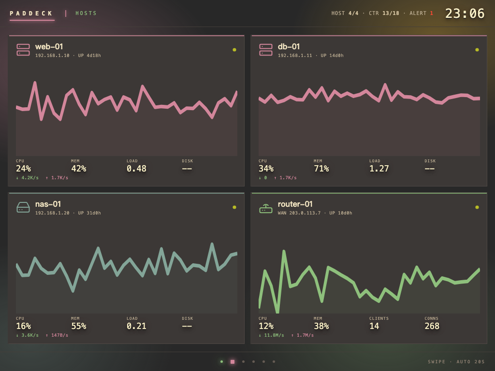
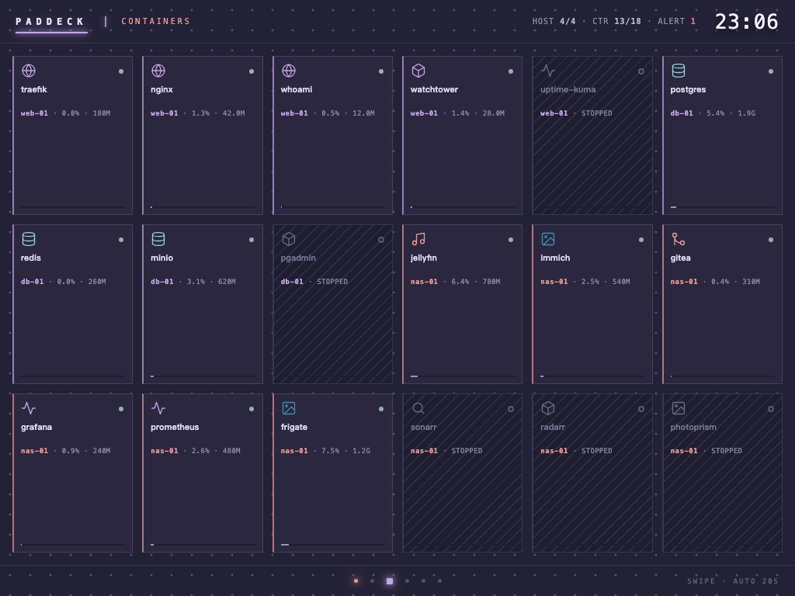
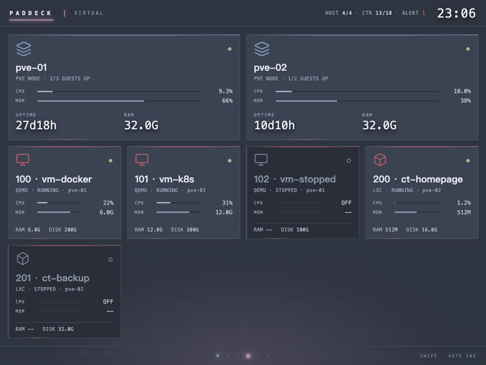
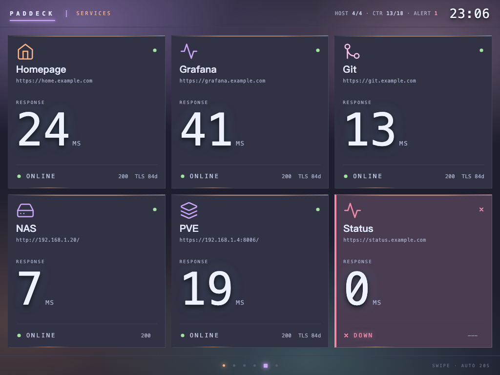
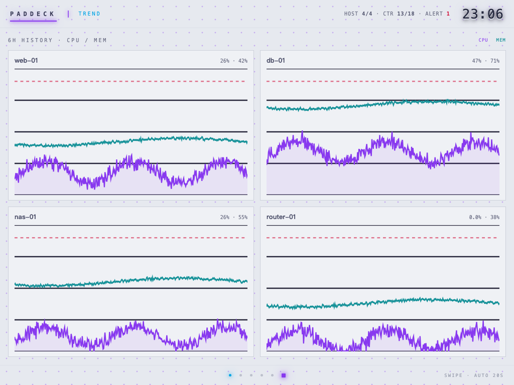
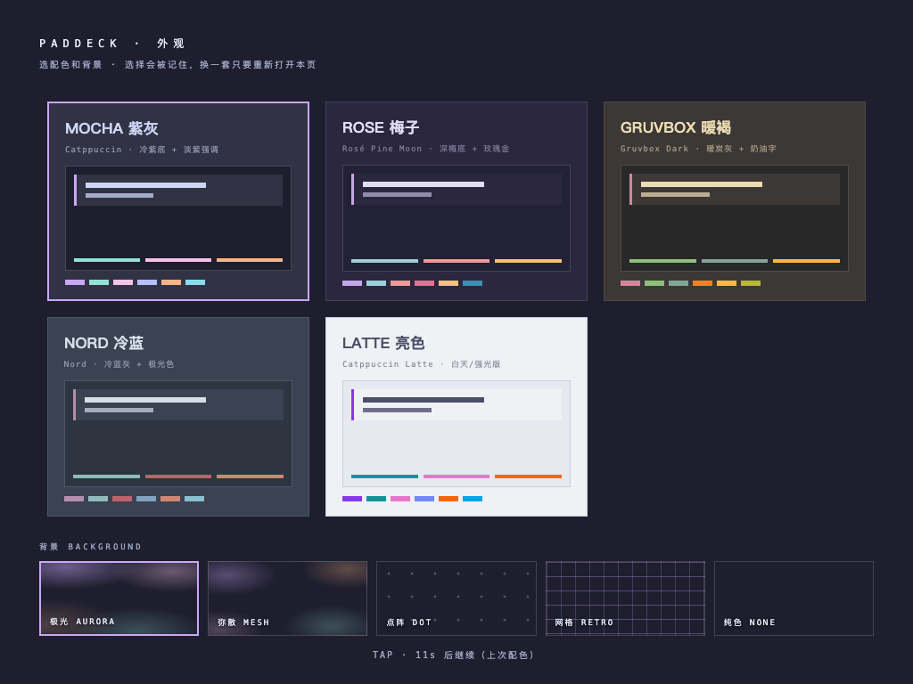

# PadDeck

> 把闲置 iPad 变成 Homelab 监控大屏。一个 Go 二进制，前端零构建，Safari 10 可用。



PadDeck 是一个自托管的局域网监控面板，专为 **iOS 10 / Safari 10 的老 iPad** 设计：
7×24 挂在墙上，6 页轮播，5 套配色、5 种背景，动效克制（只用合成层与静态渐变，
掉帧会自动降级）。不要求被监控设备装任何 agent。

## 支持什么设备

**任意组合**，只配你有的：没有的设备直接不写，不需要 SSH 的设备用 HTTP 探活也能看。

| 目标 | 需要什么 | 能看到 |
| --- | --- | --- |
| Linux 主机 | SSH | CPU / 内存 / 磁盘 / 负载 / 温度 / 网卡上下行 |
| macOS | SSH（远程登录） | CPU / 内存 / 磁盘 / 负载 / 运行时长 |
| Proxmox VE | root SSH | 节点 + QEMU/LXC 客户机 |
| 爱快 iKuai 路由 | Web API 账号 | CPU / 内存 / 在线终端 / WAN 速率 |
| 任意网页服务 | 无 | 状态码 / 延迟 / TLS 剩余天数 |
| 什么都还没有 | 无 | `paddeck -demo` 先看效果 |

## 截图

| | |
| --- | --- |
|  主机：每台一张卡，CPU 曲线 + 资源 + 网卡 |  容器：标注所属机器，停机斜线纹理 |
|  虚拟化：PVE 节点 + 客户机 |  服务：响应时间 + 在线状态 |
|  趋势：6 小时 CPU/内存曲线 |  打开时选配色和背景 |

## 快速开始

### 推荐：让 AI Agent 帮你部署

每人环境都不一样（有人只有 NAS，有人只有几个网页，有人是 PVE 集群），与其让你改一份
「别人家的配置」，不如把下面这段丢给会执行命令的 AI 编程助手（Claude Code / Cursor /
Codex / Aider …），它会探测你的环境、问你有哪几台设备、写好配置、跑 `-check` 并修到全绿：

```text
帮我在这台机器上部署 PadDeck：https://github.com/JunyuZhan/paddeck
先检查 go/docker 环境，再逐项问我有哪些监控目标（Linux 主机 / NAS / PVE / 爱快 / 网址），
按我实际有的设备生成 config.yaml（密码用 ${ENV} 占位），跑 ./paddeck -check 直到全部 ok，
最后告诉我访问地址和 iPad 添加主屏的步骤。
```

完整提示词（含安全要求与逐步验收）：[docs/deploy-with-agent.md](docs/deploy-with-agent.md)

### 手动部署

```bash
git clone https://github.com/JunyuZhan/paddeck.git && cd paddeck
go build -o paddeck ./cmd/paddeck      # 或下载 release 里的二进制

./paddeck -init                        # 生成 config.yaml
vi config.yaml                         # 填你的机器 / 网址
./paddeck -check                       # 逐项体检：SSH、docker、PVE、爱快、HTTP
./paddeck                              # http://localhost:9080
```

Docker：

```bash
cp config.example.yaml config.yaml
mkdir -p keys && ssh-keygen -t ed25519 -f keys/paddeck_ro -N ""
ssh-copy-id -i keys/paddeck_ro.pub you@192.168.1.10
docker compose up -d --build
```

### 先看看效果（不连任何设备）

```bash
./paddeck -demo     # 合成数据，不需要配置文件，打开 http://localhost:9080
```

## 外观

打开页面先选外观：配色 5 套（Mocha / Rosé Pine / Gruvbox / Nord / Latte），背景 5 种
（极光 / 弥散渐变 / 点阵 / 透视网格 / 纯色），选择会记住。也可以直接用 URL 跳过：

```
http://<host>:9080/?theme=gruvbox&bg=aurora
```

## 文档

| 文档 | 内容 |
| --- | --- |
| [配置说明](docs/configuration.md) | 每个字段、每种设备的配置方法与排错 |
| [用 AI Agent 部署](docs/deploy-with-agent.md) | 可直接粘贴的提示词与验收清单 |
| [开发指南](docs/development.md) | 本地开发、加采集器、加主题/背景、提交规范 |
| [设计文档](docs/design.md) | 架构、采集协议、数据模型、前端取舍 |
| [开发计划](docs/roadmap.md) | 路线图、视觉风格评估、技术债、ADR |
| [变更记录](CHANGELOG.md) | 版本变更 |

## 安全

面板**没有登录**，只应部署在可信内网；SSH 建议用专用只读密钥，密码用 `${ENV_VAR}` 注入。
详见 [SECURITY.md](SECURITY.md)。

## 参与

见 [CONTRIBUTING.md](CONTRIBUTING.md)。安全问题请按 [SECURITY.md](SECURITY.md) 私下报告。

## License

MIT © JunyuZhan
